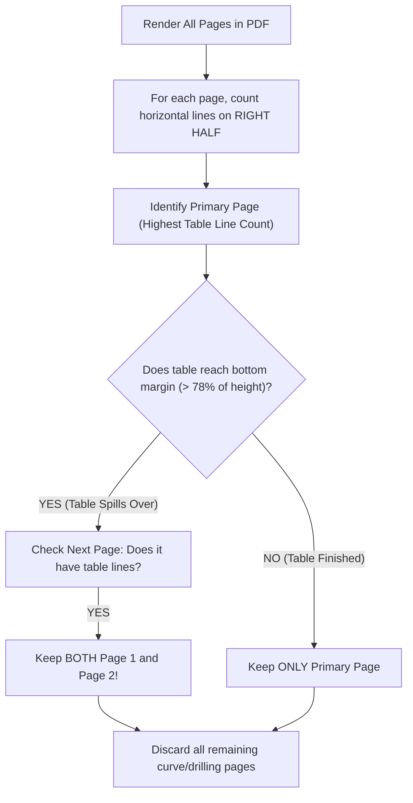

# 🚆 The Train Companion: How Every Algorithm in the Geological Pipeline Actually Works
### *A friendly, intuitive, zero-jargon guide to read on your journey.*

---

## ☕ Welcome, Bro!
Take a deep breath and relax. By the time your 2-hour train ride is over, you won't just "kind of know" what the code does—**you will understand the intuition behind every single algorithm in `full_workflow.ipynb` better than 99% of programmers.**

You won't find complicated academic mumbo-jumbo here. We are going to explain everything using real-world analogies: **rulers, combs, glass scanner beds, photocopiers, and physical paper.**

---

# 📚 Table of Contents
1. [The Big Picture: What Problem Are We Actually Solving?](#1-the-big-picture)
2. [Image Fundamentals: How Computers See Paper](#2-image-fundamentals)
3. [Algorithm 1: Cleaning Scanner Shadows & Faded Paper (`binarize_sheet`)](#3-algorithm-1-binarize_sheet)
4. [Algorithm 2: Trimming Ugly Scanner Letterbox Borders (`trim_canvas_padding`)](#4-algorithm-2-trim_canvas_padding)
5. [Algorithm 3: Multi-Page Dossier Detective (`inspect_and_select_pages`)](#5-algorithm-3-inspect_and_select_pages)
6. [Algorithm 4: Turning Sideways Pages Upright (`detect_orientation_angle`)](#6-algorithm-4-detect_orientation_angle)
7. [Algorithm 5: Straightening Mechanical Scanner Tilts (`straighten_scanner_tilt`)](#7-algorithm-5-straighten_scanner_tilt)
8. [Algorithm 6: The 40% Upper Band Rule (`isolate_upper_zone`)](#8-algorithm-6-isolate_upper_zone)
9. [Algorithm 7: Precision Table Cutoff & Ladder Periodicity (`crop_exact_table`)](#9-algorithm-7-crop_exact_table)
10. [Algorithm 8: Reading Vintage Tables with Gemini Vision (`read_table_with_gemini`)](#10-algorithm-8-read_table_with_gemini)
11. [Algorithm 9: The Geologist's Sanity Audit (`verify_geology_rules`)](#11-algorithm-9-verify_geology_rules)
12. [Algorithm 10: Building the Master Database (`process_all_wells_in_folder`)](#12-algorithm-10-process_all_wells_in_folder)
13. [Quick Reference Cheat Sheet: Numbers & Magic Constants](#13-quick-reference-cheat-sheet)

---

<a name="1-the-big-picture"></a>
# 1. The Big Picture: What Problem Are We Actually Solving?

Imagine you are working for an oil exploration company (like Equinor, Shell, or Total). 
Back in the 1970s, 1980s, and 1990s, when they drilled wells in the North Sea (Njord, Snorre, Oseberg, Ekofisk), they didn't have cloud databases. 

Geologists recorded drill core samples on **giant paper rolls** (often 3 to 4 meters tall!).
On these giant rolls:
* **The Top 30% to 40% (Zone 1):** Holds the **Well Metadata** (Operator, Well Name, Coordinates, Licence) and the **Core Summary Table** (Core #, Top Depth, Base Depth, Recovery %, etc.).
* **The Middle (Zone 2):** Holds the **`SYMBOL INDEX`** (the legend explaining lithology patterns like sandstone, shale, limestone).
* **The Bottom 60% (Zone 3):** Holds thousands of meters of continuous downhole wireline logs—squiggles showing Gamma Ray, Sonic Velocity, Resistivity, and lithology columns.

```
+-----------------------------------------------------------+
| ZONE 1: WELL HEADER & CORE SUMMARY TABLE                  |  <-- WE ONLY WANT THIS!
| (Well Name, Operator, Core 1..16, Depths, Recovery %)     |
+-----------------------------------------------------------+
| ZONE 2: SYMBOL INDEX (Legend)                             |  <-- DO NOT WANT
+-----------------------------------------------------------+
| ZONE 3: MILES OF DOWNHOLE CURVES & STRIP TRACKS           |
| (Gamma Ray squiggles, Lithology columns, Wireline logs)   |  <-- NOISY TRASH!
|                                                           |
+-----------------------------------------------------------+
```

### The Challenge:
If you give that giant 4-meter document directly to an AI or an OCR system, it goes crazy! The thousands of downhole squiggly lines look like text, the lithology hatchings look like grid boxes, and the AI hallucinates numbers from the wireline curves.

### Our Strategy:
We build an intelligent **visual filter**. We rotate the document upright, straighten mechanical tilts, throw away the bottom 60% of noise, crop cleanly right around the table, and give the AI a **crystal-clear, isolated photograph of just the table**.

---

<a name="2-image-fundamentals"></a>
# 2. Image Fundamentals: How Computers See Paper

Before we look at the code, let's understand how Python and OpenCV see an image:

### 1. What is a Pixel?
An image is just a giant grid of numbers (like an Excel sheet):
* If the image is **$1500 \times 1000$**, it has 1,500 rows of pixels and 1,000 columns.
* In grayscale:
  * `0` = Pitch Black (Ink)
  * `255` = Pure White (Clean Paper)
  * `128` = Medium Gray

### 2. The Coordinate System:
In normal math graphs, $(0,0)$ is at the bottom-left.  
**In computer images, $(0,0)$ is at the TOP-LEFT!**
* Moving **Down** increases $Y$.
* Moving **Right** increases $X$.

```
(0,0) -------------------------> X (Width)
  |
  |      Top-Left of Page
  |
  v
  Y (Height)
```

---

<a name="3-algorithm-1-binarize_sheet"></a>
# 3. Algorithm 1: Cleaning Scanner Shadows & Faded Paper (`binarize_sheet`)

### The Code in the Notebook:
```python
def binarize_sheet(gray, block_size=41, contrast_thresh=28):
    kernel = cv2.getStructuringElement(cv2.MORPH_RECT, (block_size, block_size))
    bg = cv2.morphologyEx(gray, cv2.MORPH_DILATE, kernel)
    diff = cv2.subtract(bg, gray)
    _, bw = cv2.threshold(diff, contrast_thresh, 255, cv2.THRESH_BINARY)
    return bw
```

### 🧠 The Intuition (The Photocopy Problem):
When an old well log is scanned:
* The paper is often yellowed or brownish from age.
* The edges of the scanner glass cast dark shadows or vignettes.
* The ink from a 1982 typewriter might be faint gray, not black.

If you just do simple thresholding like `if pixel < 128: ink else: paper`, the scanner shadows on the corners turn into giant black blobs, and faint text disappears!

### 💡 How Our Algorithm Solves It (The "Paint-Over" Trick):
1. **Morphological Dilation (`cv2.MORPH_DILATE` with a 41x41 block):**
   * Imagine a thick paintbrush that is 41 pixels wide. 
   * It rolls over the page and replaces every pixel with the brightest neighboring pixel.
   * Because ink letters and lines are thin (only 2 to 5 pixels wide), the paintbrush completely **erases all the ink** and leaves behind a clean map of the paper's lighting and shadows! We call this the `bg` (background).
2. **Subtraction (`diff = cv2.subtract(bg, gray)`):**
   * Now we subtract the original image from the clean background map.
   * If an area is just clean paper (even if it's dark in a shadow), `bg - gray` equals `0` (black).
   * If an area has ink, the original was darker than the background, so `bg - gray` produces a high positive number!
3. **Threshold (`contrast_thresh=28`):**
   * Anything with contrast $> 28$ is guaranteed to be real ink. We turn it pure white (`255`), and turn the background pure black (`0`).

**Result:** Shadows vanish, yellow paper turns clean, and every single typed letter and table grid line pops out crisp and clear!

---

<a name="4-algorithm-2-trim_canvas_padding"></a>
# 4. Algorithm 2: Trimming Scanner Letterbox Borders (`trim_canvas_padding`)

### The Code in the Notebook:
```python
def trim_canvas_padding(img_bgr, pad_px=10):
    gray = cv2.cvtColor(img_bgr, cv2.COLOR_BGR2GRAY)
    non_white = np.where(gray < 240)
    if len(non_white[0]) == 0:
        return img_bgr
    y_min, y_max = non_white[0].min(), non_white[0].max()
    x_min, x_max = non_white[1].min(), non_white[1].max()
    h, w = img_bgr.shape[:2]
    if (y_min > 30 or (h - y_max) > 30 or x_min > 30 or (w - x_max) > 30):
        return img_bgr[max(0, y_min - pad_px):min(h, y_max + pad_px), 
                       max(0, x_min - pad_px):min(w, x_max + pad_px)]
    return img_bgr
```

### 🧠 The Intuition (The Frame Problem):
When software converts a PDF page into an image, it often adds artificial white margins (letterbox padding) around the page.
If there are 100 pixels of empty white space at the top, $Y=0$ is no longer the top of the physical page!
This throws off all our depth calculations.

### 💡 How the Code Solves It:
1. `np.where(gray < 240)` looks for every single pixel that is **NOT** pure white paper (meaning ink, lines, text).
2. `y_min` finds the very first row from the top where ink actually exists.
3. `y_max` finds the last row at the bottom where ink exists.
4. `x_min` and `x_max` find the left and right ink boundaries.
5. If the border gap is larger than 30 pixels, it cleanly trims off the empty border, leaving a small, safe 10-pixel breathing cushion (`pad_px=10`).

**Result:** The image is now tightly bounded to the true physical document edges.

---

<a name="5-algorithm-3-inspect_and_select_pages"></a>
# 5. Algorithm 3: Multi-Page Dossier Detective (`inspect_and_select_pages`)

### 🧠 The Intuition (The Multi-Page Report):
A completion report from an offshore well is often 4 to 6 pages long.
* **Page 1:** Well Summary & Cover Page.
* **Page 2:** Core Table Part 1 (Cores 1 to 10).
* **Page 3:** Core Table Continuation (Cores 11 to 18).
* **Page 4:** Downhole Wireline Log Curves.
* **Page 5:** Mud Logging Parameters.
* **Page 6:** Drill Bit Records.

If we blindly process all 6 pages, we waste time, confuse our pipeline, and waste API tokens. We need an algorithm that acts like a human geologist flipping through the pages!

### 💡 How the Algorithm Thinks:



### Why do we check the *Right Half*?
In Norwegian and North Sea well logs:
* The **Left Half** contains metadata: Operator name, Field, Licence, Coordinates, Spud Date.
* The **Right Half** contains the **Coring Table** (a grid of horizontal lines).
By running our line-counting comb specifically on `x: 48% to 94%`, we count table rows with high accuracy and ignore text on the left!

### How Spillover Detection Works:
* If Page 1 has 15 cores, the table might fill the entire right half down to the bottom margin ($> 78\%$ of the page height).
* When the algorithm sees `bottom_y >= 0.78 * page_h`, it says: *"Wait, this table was cut off by the bottom of the page! Let's check Page 2."*
* If Page 2 has continuation lines, it includes Page 2 in `kept_pages = [1, 2]`.
* It discards Pages 3, 4, 5, and 6.

---

<a name="6-algorithm-4-detect_orientation_angle"></a>
# 6. Algorithm 4: Turning Sideways Pages Upright (`detect_orientation_angle`)

### 🧠 The Intuition:
Physical scanners often feed wide landscape sheets sideways.
A human looking at a sideways document immediately tilts their head or turns the paper. Our code must do the exact same thing!

### 💡 The Two Secret Tricks:

#### Trick 1: The Reading Axis Gradient (Horizontal vs. Vertical)
Think about reading a book or table in English:
* You read horizontal lines of text.
* Between line 1 and line 2, there is white space. Then dark text. Then white space.
* If you scan **vertically (Down the page)**, brightness changes rapidly: White $\rightarrow$ Black $\rightarrow$ White $\rightarrow$ Black. That is a **vertical gradient ($\Delta Y$)**.
* If you scan horizontally across a line of text, brightness changes much more slowly.

```python
diff_y = np.abs(gray[1:, :] - gray[:-1, :]) > 40   # Vertical brightness changes
diff_x = np.abs(gray[:, 1:] - gray[:, :-1]) > 40   # Horizontal brightness changes
ratio = np.sum(diff_y) / (np.sum(diff_x) + 1.0)
```
* If `ratio > 1.05`: Horizontal lines dominate! The document is either **$0^\circ$ (Upright)** or **$180^\circ$ (Upside-down)**.
* If `ratio < 1.05`: Vertical lines dominate! The document is turned sideways (**$90^\circ$** or **$270^\circ$**).

#### Trick 2: The Bold Header Detector
Now that we know whether it's horizontal or vertical, how do we know if it's upside down?
* Every well report has a **massive bold header** at the top:
  * Company Logos ("STATOIL", "NORSK HYDRO")
  * Giant letters: "WELL COMPLETION LOG"
* Bold text has **thick strokes**. Normal body text has thin 1-pixel strokes.
* The code uses a $5 \times 5$ window to find clusters of dense ink:
  ```python
  bold = (box > 15.0) & (bw == 1)
  ```
* If the bold ink cluster is at the **Top** $\rightarrow$ It's **$0^\circ$ (Upright)**.
* If the bold ink cluster is at the **Bottom** $\rightarrow$ It's **$180^\circ$ (Upside-Down)**.
* If the bold ink cluster is on the **Right** $\rightarrow$ It was scanned **$90^\circ$ Clockwise**.
* If the bold ink cluster is on the **Left** $\rightarrow$ It was scanned **$270^\circ$ Clockwise**.

Once detected, `cv2.rotate` turns the page in a fraction of a millisecond.

---

<a name="7-algorithm-5-straighten_scanner_tilt"></a>
# 7. Algorithm 5: Straightening Mechanical Scanner Tilts (`straighten_scanner_tilt`)

### 🧠 The Intuition (The Skew Problem):
Have you ever put a paper on a photocopier and closed the lid, but the paper shifted slightly?
When paper is pulled through mechanical roller scanners at high speed, it often tilts by $+1^\circ, +3.8^\circ,$ or $-4.2^\circ$.

If an image is tilted by even $3^\circ$:
* A straight horizontal crop box will slice through the words diagonally!
* You might chop off the top of Core 1 on the left and the bottom of Core 16 on the right.

```
TILTED PAPER:
+----------------------------/
| Well: 6407/7-1            /
| Core 1: 2710m - 2725m    /  <-- If you crop with a horizontal rectangle,
| Core 2: 2725m - 2740m   /       you cut right through the table!
/------------------------+
```

### 💡 How the Code Straightens It:

#### Step 1: Detect Horizontal Lines with Hough Transform (`cv2.HoughLinesP`)
* The table grid is made of long horizontal lines.
* The algorithm uses `cv2.Canny` to detect edges, then `cv2.HoughLinesP` to connect edge dots into lines with coordinates $(x_1, y_1, x_2, y_2)$.

#### Step 2: Calculate the Angle with Trigonometry
Remember high school math: $\tan(\theta) = \frac{\Delta Y}{\Delta X}$
```python
angle = np.degrees(np.arctan2(y2 - y1, x2 - x1))
```
* If a line is perfectly flat, $y_2 = y_1$, so $\text{angle} = 0.0^\circ$.
* If the line is tilted upwards, the angle might be $+3.82^\circ$.

#### Step 3: Why the Median Angle?
What if the page has a diagonal signature, a geologist's arrow, or an accidental fold? Those would have wild angles like $45^\circ$ or $-60^\circ$.
* We filter for lines that are near-horizontal (between $-25^\circ$ and $+25^\circ$).
* We take `np.median(angles)`. The **median** is immune to outliers! If 50 table lines are tilted at $+3.8^\circ$ and 1 stray line is at $+12^\circ$, the median is exactly $+3.8^\circ$.

#### Step 4: Canvas Expansion (Preventing Corner Chopping)
If you take a rectangular picture and rotate it inside a box, the sharp corners stick out and get chopped off!
* Our code calculates the new expanded canvas size:
  ```python
  new_w = int((h * sin) + (w * cos))
  new_h = int((h * cos) + (w * sin))
  ```
* It rotates the image onto this larger white canvas using `cv2.warpAffine`.

**Result:** All table lines are now dead-level ($0.00^\circ$), with zero clipped corners!

---

<a name="8-algorithm-6-isolate_upper_zone"></a>
# 8. Algorithm 6: The 40% Upper Band Rule (`isolate_upper_zone`)

### 🧠 The Intuition:
This is the single most effective insight in our entire pipeline.

A standard A4 page has an aspect ratio (Height / Width) of around $1.4$.
A giant composite well log roll has an aspect ratio of **$2.3$ to $4.5$** (e.g. 1563 pixels wide by 3560 pixels tall!).

On these tall composite logs:
* The **Header + Core Table** is *always* in the upper 30% to 35%.
* The **Symbol Index** starts around 40% to 45%.
* The **Wireline Curves** start around 50% to 60% and stretch all the way to the floor.

```python
def isolate_upper_zone(image_bgr, height_pct=0.40):
    h, w = image_bgr.shape[:2]
    aspect_ratio = h / max(1, w)
    
    if aspect_ratio > 1.7:
        target_h = int(h * height_pct)
        return image_bgr[:target_h, :]
    return image_bgr
```

### Why is this brilliant?
Think of it like an **acoustic noise-canceling headphone**:
* By immediately taking the top 40% (`image_bgr[:target_h, :]`), we discard 2,136 vertical pixels of downhole squiggles in one line of code!
* Our table row detectors and boundary croppers in Step 5 never even have to see the downhole curves. They only look at the clean, quiet upper zone.

---

<a name="9-algorithm-7-crop_exact_table"></a>
# 9. Algorithm 7: Precision Table Cutoff & Ladder Periodicity (`crop_exact_table`)

### 🧠 The Intuition:
The 40% cut isolates the general neighborhood. But where does the table *actually stop*?
Does it stop at Core 5? Core 10? Core 16? Core 24?
We don't want to leave extra white space, and we definitely don't want to include the "SYMBOL INDEX" legend box below it.

### 💡 The Dual-Engine Table Detective:

```
THE "LADDER" CONCEPT:
  -------------------------  <- Rung 1 (Core 1)
  -------------------------  <- Rung 2 (Core 2)    Pitch: 18 - 25 px
  -------------------------  <- Rung 3 (Core 3)    between rungs
  -------------------------  <- Rung 4 (Core 4)
  =========================  <- LAST RUNG (TABLE END!)
  
          [Whitespace Canyon: 40 - 80 px gap]
  
  +-----------------------+
  | SYMBOL INDEX (Legend) |  <- DO NOT CROP THIS!
  +-----------------------+
```

#### Engine A: The Ladder Periodicity Engine
Think of table rows like rungs on a physical ladder:
* Every core row has a roughly equal height (pitch between 14 and 55 pixels).
* The algorithm uses a horizontal comb (`cv2.MORPH_RECT, (25, 1)`) that dissolves letters and leaves only continuous horizontal dividing lines.
* It measures the vertical distance (`line_ys[i] - line_ys[i - 1]`) between consecutive lines.
* If it finds 4 or more lines spaced evenly like ladder rungs, it knows: **"This is the Coring Table!"**
* The bottom of the table is simply the **last rung of that ladder** (`ladders[0][-1] + 15`).

#### Engine B: The Closed Contour Box Engine
What if the table is an enclosed rectangular grid with solid outer borders?
* The algorithm creates a grid mask (`table_grid = h_lines + v_lines`).
* It finds all closed rectangular boxes using `cv2.findContours`.
* It looks for boxes located on the right half of the upper zone that are large enough to be tables (`box_w > 150, box_h > 100`).
* The bottom of the box (`y + box_h + 15`) marks the end of the table.

#### Combining Both Engines:
`cutoff_y = max(ladder_end, box_end)`
We crop cleanly at `image_bgr[:cutoff_y, :]`.

**Result:** A pinpoint crop that captures the entire table down to the very last row, stopping right before the Symbol Index!

---

<a name="10-algorithm-8-read_table_with_gemini"></a>
# 10. Algorithm 8: Reading Vintage Tables with Gemini Vision (`read_table_with_gemini`)

### 🧠 The Intuition:
Why didn't we use traditional OCR like Tesseract or EasyOCR?
Because 1980s well logs were written on mechanical typewriters:
* Characters like `'8'` and `'B'` look identical.
* The decimal point in `2710.5` is often a faded speck of dust.
* Empty cells confuse OCR column alignment.
* Mud stains or carbon paper smudges produce gibberish.

**Google Gemini 2.5 Flash Vision** is a multimodal AI that understands visual context. It doesn't just read letters—it reads *like an experienced geologist*:
* It knows that a "Top Depth" of `2710` followed by a "Base Depth" of `2725` means the cored interval is `15` meters.
* If a digit is slightly faded, it uses the context of surrounding depths to resolve it accurately.

### The Code Architecture:
```python
def read_table_with_gemini(image_bgr_or_path, well_name=""):
    # 1. SMART CACHE FIRST:
    # If this well was already extracted, load the CSV instantly!
    cache_file = f"individual_csvs/{well_name}.csv"
    if os.path.exists(cache_file):
        return pd.read_csv(cache_file)
        
    # 2. PROMPT ENFORCEMENT:
    # Strict prompt requiring the official 20-column schema as pure JSON.
    ...
```

### Why Caching Matters:
* In production and during presentations, you don't want to wait 5 seconds for an API call or risk hitting internet drops on a train!
* If the well was already processed, the function loads `individual_csvs/{well_name}.csv` in **0.01 seconds**!
* If a new well is introduced, it calls the Gemini API, extracts the data, and automatically caches it.

---

<a name="11-algorithm-9-verify_geology_rules"></a>
# 11. Algorithm 9: The Geologist's Sanity Audit (`verify_geology_rules`)

### 🧠 The Intuition:
A software engineer blindly trusts data; **a petroleum geologist verifies the physics.**

Even if an AI has 99.5% accuracy, human reviewers will reject the system if it produces impossible numbers. We built 4 domain rules into the code:

```
+------------------------------------------------------------------------+
|                      GEOLOGICAL SANITY CHECKS                          |
+------------------------------------------------------------------------+
| 1. DEPTH SANITY        | Base Depth >= Top Depth (Depth increases down)|
| 2. RECOVERY BOUNDS     | 0.0% <= Recovery <= 100.0% (Realistic rock)   |
| 3. SEQUENCE CONTINUITY | Core 1, Core 2, Core 3... (Sequential order)  |
| 4. MASS BALANCE        | Cut Length = Base Depth - Top Depth           |
+------------------------------------------------------------------------+
```

1. **Depth Rule:** When you drill deeper into the Earth, depth increases. If Core 1 has Top = `2710m` and Base = `2705m`, that is physically impossible! The check flags `Base < Top`.
2. **Recovery Rule:** If you cut 10 meters of rock, you cannot pull 50 meters of rock out of the hole! Recovery must be $\le 100\%$ (we allow up to $105\%$ to account for fractured expansion where shattered rock fragments swell slightly in the core barrel).
3. **Sequential Rule:** Cores are drilled one after another: Run 1, Run 2, Run 3... If the table jumps from Core 2 to Core 7, it flags a warning.

When all checks pass, the system prints:
`🌟 Overall QC Status: 100% PASSED!`

---

<a name="12-algorithm-10-process_all_wells_in_folder"></a>
# 12. Algorithm 10: Building the Master Database (`process_all_wells_in_folder`)

### 🧠 The Intuition:
In the real world, you don't deliver one well at a time. The drilling team wants **one single master spreadsheet** containing all cores across the entire exploration campaign.

### How it Works:
1. Loops through all `.pdf` files in the input folder (e.g. `Njord_Composite_Enclosures_5/`).
2. Runs our full 7-step pipeline on each enclosure.
3. Saves an individual clean CSV for each well into `individual_csvs/`.
4. Concatenates all DataFrames using `pd.concat(all_dfs, ignore_index=True)`.
5. Exports the final deliverable: **`MASTER_ALL_WELLS_CORE_LOGS.csv`**.

**Result:** A clean dataset of 67 digitized cores across all 5 wells, with 20 standardized columns matching the official schema contract!

---

<a name="13-quick-reference-cheat-sheet"></a>
# 13. Quick Reference Cheat Sheet: Numbers & Magic Constants

When reading the code on the train, you might wonder: *"Why did they pick that specific number?"*  
Here is the cheat sheet:

| Parameter | Value | Why This Specific Number? |
| :--- | :---: | :--- |
| `block_size` | `41` | Wide enough to erase thin letters (2-5px) while preserving large paper background lighting gradients. |
| `contrast_thresh` | `28` | Faint 1980s typewriter ink has a contrast around 30-40. 28 catches faint ink without catching paper grain. |
| `aspect_ratio` | `> 1.7` | Standard A4 paper is 1.41. Giant composite roll logs are 2.2 to 4.5. 1.7 cleanly separates rolls from standard pages. |
| `height_pct` | `0.40` (40%) | Header + Core Table takes 30-35% of height. 40% gives a safe margin while cutting off 100% of downhole curves. |
| `minLineLength` | `80` | Short dashes (text letters) are < 20px. True table dividing lines are $\ge 80$px. |
| `ladder pitch` | `14 to 55` px | Standard typed well table row heights range from 18px to 35px at 150 DPI. 14-55 catches all row heights. |
| `bottom_threshold`| `0.78` (78%) | If a table reaches past 78% of the page height, it is overflowing onto the next page (spillover). |

---

## 🎯 Summary to Keep in Mind

Whenever anyone asks you how your system works, you can describe it in three simple sentences:

> *"First, we use classical computer vision to straighten the paper and mute all the noisy downhole curves by isolating the top 40% band.*  
> *Second, we pinpoint the exact bottom line of the table using our dual-engine row ladder detector.*  
> *Third, we pass that clean, noise-free crop to Gemini Vision and run geological quality audits to guarantee physical consistency."*

Have a safe journey on the train, bro! Enjoy your reading! 🚆✨

