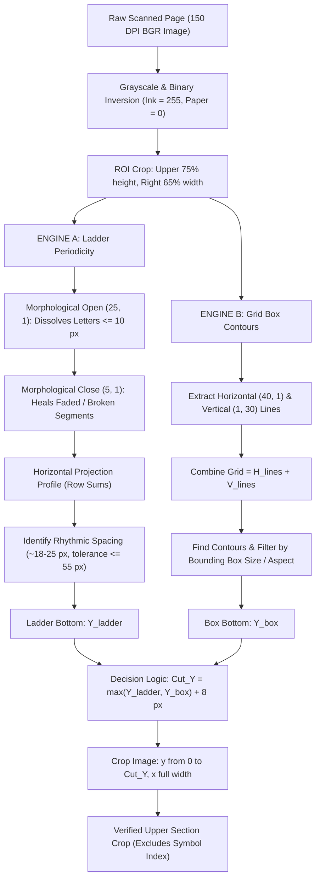

# 📘 Study Note & Technical Reference: Core Log Dynamic Section Cropper

> **A complete study guide and technical architecture manual for dynamically detecting and cropping the upper data section of scanned core logs, strip logs, and geological well reports.**

---

## 📌 1. Objective & Problem Statement

### The Goal
Given a scanned geological strip log or core log PDF/image, isolate and extract **ONLY** the upper data section containing:
1. **Top Title & Header:** Operator logo (e.g., Norsk Hydro, Equinor), Core Log title, Well ID (e.g., `31/2-1`), Date, Scale.
2. **Left Metadata Block:** Country, Field, Licence, Coordinates, Depths, Geologists, Remarks.
3. **Right Coring Summary Table:** Core numbers, cored intervals, recovered length, recovery %, formations.

### What Must Be Completely Excluded
- The **`SYMBOL INDEX`** banner and lithology pattern legend boxes.
- Downhole **graphical log curves** (Gamma Ray, Sonic, Resistivity, Stratigraphic lithology columns).

### Why Fixed / Hardcoded Cropping Fails
- **Variable Table Heights:** A well might describe 3 cores (table height ~100 px) or 25+ cores (table height > 1000 px, as in `synth_normal_11.pdf`).
- **Pushed-Down Symbol Index:** In long core documents, the SYMBOL INDEX banner is pushed further down the sheet to accommodate the table.
- A fixed cutoff (e.g., $Y = 700\text{ px}$) either cuts through long tables or includes unwanted graphical curve data on short tables.

---

## 🏗️ 2. The Two Fundamental Table Archetypes

| Feature | Archetype A: Closed / Boxed Tables | Archetype B: Open / Frameless Tables |
| :--- | :--- | :--- |
| **Example** | `synth_normal_01.pdf` through `11.pdf` | User-uploaded image (`synth_open_table_full.pdf`) |
| **Grid Lines** | Full horizontal row lines **AND** vertical column dividers | **Zero vertical divider lines**; columns separated purely by whitespace |
| **Visual Appearance** | Enclosed grid boxes | Stacks of horizontal parallel lines (looks like a ladder) |
| **Why `cv2.findContours` Fails** | Works well because rectangles are closed polygons ($4$ vertices) | **Fails completely ($0$ boxes found)** because open horizontal lines do not enclose an area |
| **Solution Engine** | Engine B: Grid Box Contour Detector | Engine A: Ladder Periodicity Engine |

---

## ⚙️ 3. The Dual-Engine Algorithm Architecture

The system runs two complementary computer vision engines in parallel and merges their outputs:



---

## 🔬 4. Mathematical & Morphological Breakdown

### Step 1: Text Dissolution via Morphological Opening
- **Problem:** Printed letters (like `A`, `E`, `T`, `H`) contain small horizontal bar strokes that could be mistaken for table lines.
- **Physics of Type:** At 150 DPI, standard text characters are $\le 10\text{ px}$ wide. Real table ruling lines are $\ge 150\text{ px}$ wide.
- **Operation:**
  $$\text{Opened} = \text{erode}(BW, K) \circ \text{dilate}(BW, K), \quad K = \text{rect}(25, 1)$$
  Any ink structure narrower than $25\text{ px}$ vanishes completely. Table lines remain intact.

### Step 2: Line Healing via Morphological Closing
- **Problem:** Faint ink, vintage typewriter ribbon, or scanner noise causes ruling lines to have tiny 1–3 px gaps.
- **Operation:**
  $$\text{Healed} = \text{dilate}(\text{Opened}, K_{\text{heal}}) \circ \text{erode}(\text{Opened}, K_{\text{heal}}), \quad K_{\text{heal}} = \text{rect}(5, 1)$$
  Bridges broken segments into one continuous line.

### Step 3: Horizontal Projection Profile & Centroid Peak Finding
- Count white line pixels along each row $y$:
  $$P(y) = \sum_{x \in \text{ROI}} I(x, y)$$
- Rows where $P(y) > 35 \times 255$ represent physical ruling lines.
- Because a line is 1–3 pixels thick, adjacent rows are clustered using itertools `groupby`:
  $$\bar{y}_{\text{line}} = \frac{1}{|G|} \sum_{y \in G} y$$

### Step 4: The Ladder Tracking Algorithm
- Real tables exhibit **vertical periodicity**: rows have consistent height ($\approx 18\text{--}25\text{ px}$).
- Consecutive line spacing $\Delta y = y_{i} - y_{i-1}$ is evaluated:
  - **Normal row:** $14\text{ px} \le \Delta y \le 28\text{ px}$.
  - **Faded / missing single rung:** $28\text{ px} < \Delta y \le 55\text{ px}$ (bridges the gap without stopping).
  - **Table end (whitespace valley before SYMBOL INDEX):** $\Delta y > 55\text{ px}$ (ladder terminates).
- A valid table requires $\ge 4$ consecutive rungs. The bottom-most rung gives $Y_{\text{ladder}}$.

---

## 📊 5. Benchmark Results Across Test Suite (`01_normal_straight`)

Tested on all 12 documents in `ergon-data-study/generated_test_documents/01_normal_straight/`:

| Document | Archetype | Page Size | Cut Line ($Y$) | Engines Triggered | SYMBOL INDEX Status | Output Crop Link |
| :--- | :--- | :---: | :---: | :--- | :---: | :--- |
| `synth_normal_01.pdf` | Boxed | $1600 \times 1168$ | **$676\text{ px}$** | Ladder ($18$ lines) + GridBox | **Excluded** | [synth_normal_01_cropped.png](file:///c:/Users/user/Downloads/ergon-data-study/ergon-data-study/crops_01_normal_straight/synth_normal_01_cropped.png) |
| `synth_normal_02.pdf` | Boxed | $1600 \times 1168$ | **$676\text{ px}$** | Ladder ($18$ lines) + GridBox | **Excluded** | [synth_normal_02_cropped.png](file:///c:/Users/user/Downloads/ergon-data-study/ergon-data-study/crops_01_normal_straight/synth_normal_02_cropped.png) |
| `synth_normal_03.pdf` | Boxed | $1600 \times 1168$ | **$676\text{ px}$** | Ladder ($18$ lines) + GridBox | **Excluded** | [synth_normal_03_cropped.png](file:///c:/Users/user/Downloads/ergon-data-study/ergon-data-study/crops_01_normal_straight/synth_normal_03_cropped.png) |
| `synth_normal_04.pdf` | Boxed | $1600 \times 1168$ | **$676\text{ px}$** | Ladder ($18$ lines) + GridBox | **Excluded** | [synth_normal_04_cropped.png](file:///c:/Users/user/Downloads/ergon-data-study/ergon-data-study/crops_01_normal_straight/synth_normal_04_cropped.png) |
| `synth_normal_05.pdf` | Boxed | $1600 \times 1168$ | **$676\text{ px}$** | Ladder ($18$ lines) + GridBox | **Excluded** | [synth_normal_05_cropped.png](file:///c:/Users/user/Downloads/ergon-data-study/ergon-data-study/crops_01_normal_straight/synth_normal_05_cropped.png) |
| `synth_normal_06.pdf` | Boxed | $1600 \times 1168$ | **$676\text{ px}$** | Ladder ($18$ lines) + GridBox | **Excluded** | [synth_normal_06_cropped.png](file:///c:/Users/user/Downloads/ergon-data-study/ergon-data-study/crops_01_normal_straight/synth_normal_06_cropped.png) |
| `synth_normal_07.pdf` | Boxed | $1600 \times 1168$ | **$676\text{ px}$** | Ladder ($18$ lines) + GridBox | **Excluded** | [synth_normal_07_cropped.png](file:///c:/Users/user/Downloads/ergon-data-study/ergon-data-study/crops_01_normal_straight/synth_normal_07_cropped.png) |
| `synth_normal_08.pdf` | Boxed | $1600 \times 1168$ | **$676\text{ px}$** | Ladder ($18$ lines) + GridBox | **Excluded** | [synth_normal_08_cropped.png](file:///c:/Users/user/Downloads/ergon-data-study/ergon-data-study/crops_01_normal_straight/synth_normal_08_cropped.png) |
| `synth_normal_09.pdf` | Boxed | $1600 \times 1168$ | **$676\text{ px}$** | Ladder ($18$ lines) + GridBox | **Excluded** | [synth_normal_09_cropped.png](file:///c:/Users/user/Downloads/ergon-data-study/ergon-data-study/crops_01_normal_straight/synth_normal_09_cropped.png) |
| `synth_normal_10.pdf` | Boxed | $1600 \times 1168$ | **$676\text{ px}$** | Ladder ($18$ lines) + GridBox | **Excluded** | [synth_normal_10_cropped.png](file:///c:/Users/user/Downloads/ergon-data-study/ergon-data-study/crops_01_normal_straight/synth_normal_10_cropped.png) |
| `synth_normal_11.pdf` | Deep Boxed ($25$ cores) | $1600 \times 1519$ | **$1021\text{ px}$** | Ladder ($32$ lines) + GridBox | **Excluded** | [synth_normal_11_cropped.png](file:///c:/Users/user/Downloads/ergon-data-study/ergon-data-study/crops_01_normal_straight/synth_normal_11_cropped.png) |
| `synth_open_table_full.pdf` | Open Table ($14$ rows) | $1600 \times 1168$ | **$559\text{ px}$** | Ladder ($14$ lines, open style) | **Excluded** | [synth_open_table_full_cropped.png](file:///c:/Users/user/Downloads/ergon-data-study/ergon-data-study/crops_01_normal_straight/synth_open_table_full_cropped.png) |

---

## 🚨 6. Honest Hackathon Vulnerabilities & How to Solve Them

If deploying in a real-world hackathon with messy or adversarial test data, be aware of these 5 failure modes:

### Vulnerability 1: Tilted / Skewed Scans (`02_tilted_skewed`)
- **What happens:** Paper placed crooked at a $2^\circ\text{--}4^\circ$ angle.
- **Impact:** Flat horizontal kernels `(25, 1)` cannot track slanted lines; row projection fails, triggering fallback cut.
- **Solution:** Add an automated deskew pre-processor using OpenCV:
  ```python
  def deskew_image(img_bgr):
      gray = cv2.cvtColor(img_bgr, cv2.COLOR_BGR2GRAY)
      pts = np.column_stack(np.where(gray < 200))
      angle = cv2.minAreaRect(pts)[-1]
      if angle < -45: angle = -(90 + angle)
      else: angle = -angle
      (h, w) = img_bgr.shape[:2]
      M = cv2.getRotationMatrix2D((w // 2, h // 2), angle, 1.0)
      return cv2.warpAffine(img_bgr, M, (w, h), flags=cv2.INTER_CUBIC, borderMode=cv2.BORDER_REPLICATE)
  ```

### Vulnerability 2: Rotated / Landscape Scans (`03_rotated_inverted`)
- **What happens:** Table scanned sideways ($90^\circ$ landscape).
- **Impact:** Table lines are vertical on screen; cropper detects 0 horizontal lines.
- **Solution:** Check aspect ratio or use MuPDF's page orientation before rasterizing:
  ```python
  if page.rect.width > page.rect.height:
      page.set_rotation(90)  # rotate upright
  ```

### Vulnerability 3: Rigid Search ROI Coordinates
- **What happens:** `roi_left = 0.35 * width` assumes the table is always on the right half.
- **Impact:** Formats from different oil companies with tables on the left or centered will be missed.
- **Solution:** Broaden `roi_left` to `0.10 * width` and use line length/periodicity rather than rigid quadrant placement.

### Vulnerability 4: Multi-Page Reports (`scanned_documents`)
- **What happens:** Hardcoded `doc[0]` assumes the coring summary is on Page 1.
- **Impact:** Real geological enclosure PDFs often have 10–100+ pages; coring tables might sit on Page 4 or 15.
- **Solution:** Implement a page keyword router (scan text for `"CORES DESCRIBED"`, `"CORE SUMMARY"`, or `"INTERVAL (M)"` to identify the correct page index).

### Vulnerability 5: Text Anchor Safety Net ("SYMBOL INDEX" Stop Line)
- **The Ultimate Defensive Floor:**
  If the text `"SYMBOL INDEX"` or `"LITHOLOGY"` exists in MuPDF's text layer at $Y_{\text{symbol}}$, enforce:
  $$\text{Cut\_Y} = \min(\text{detected\_table\_bottom} + 8, \, Y_{\text{symbol}} - 15)$$
  This guarantees that even if a visual detector overshoots, the SYMBOL INDEX banner can never enter the crop.

---

## 💻 7. Production Code References

### 7.1 Approach A: Table Bottom-Up Engine (`section_cropper.py`)
Uses the Dual Ladder Periodicity + Grid Box Contour engine to detect where the coring table ends and slices immediately after it.

```python
import cv2
import numpy as np
from itertools import groupby
from operator import itemgetter

def detect_table_cutoff(img_bgr: np.ndarray) -> int:
    height, width = img_bgr.shape[:2]
    gray = cv2.cvtColor(img_bgr, cv2.COLOR_BGR2GRAY)
    _, bw = cv2.threshold(gray, 220, 255, cv2.THRESH_BINARY_INV)

    # Search ROI (upper-right quadrant)
    roi_top, roi_bottom = int(height * 0.15), int(height * 0.75)
    roi_left, roi_right = int(width * 0.35), int(width * 0.95)
    roi_bw = bw[roi_top:roi_bottom, roi_left:roi_right]

    # Engine A: Ladder Periodicity (Open / Frameless Tables)
    ladder_end_y = None
    h_lines = cv2.morphologyEx(roi_bw, cv2.MORPH_OPEN, cv2.getStructuringElement(cv2.MORPH_RECT, (25, 1)))
    h_lines = cv2.morphologyEx(h_lines, cv2.MORPH_CLOSE, cv2.getStructuringElement(cv2.MORPH_RECT, (5, 1)))
    peaks = np.where(np.sum(h_lines, axis=1) > 35 * 255)[0]
    line_ys = [int(np.mean(list(map(itemgetter(1), g)))) for _, g in groupby(enumerate(peaks), lambda ix: ix[0] - ix[1])]

    if len(line_ys) >= 4:
        ladders, curr = [], [line_ys[0]]
        for i in range(1, len(line_ys)):
            if 14 <= (line_ys[i] - line_ys[i - 1]) <= 55:
                curr.append(line_ys[i])
            else:
                if len(curr) >= 4: ladders.append(curr)
                curr = [line_ys[i]]
        if len(curr) >= 4: ladders.append(curr)
        if ladders:
            ladder_end_y = roi_top + max(ladders, key=len)[-1]

    # Engine B: Grid Box Contours (Closed Tables)
    box_end_y = None
    v_lines = cv2.morphologyEx(bw, cv2.MORPH_OPEN, cv2.getStructuringElement(cv2.MORPH_RECT, (1, 30)))
    h_full = cv2.morphologyEx(bw, cv2.MORPH_OPEN, cv2.getStructuringElement(cv2.MORPH_RECT, (40, 1)))
    contours, _ = cv2.findContours(h_full + v_lines, cv2.RETR_TREE, cv2.CHAIN_APPROX_SIMPLE)
    for c in contours:
        x, y, bw_c, bh_c = cv2.boundingRect(c)
        if (x > width * 0.35 and y < height * 0.50 and bw_c > 150 and bh_c > 100 
            and bw_c < width * 0.80 and bh_c < height * 0.80):
            box_end_y = max(box_end_y or 0, y + bh_c)

    cuts = [y for y in [ladder_end_y, box_end_y] if y is not None]
    return (max(cuts) + 8) if cuts else int(height * 0.50)
```

### 7.2 Approach B: "SYMBOL INDEX" Boundary-Driven Cropper (`crop_by_symbol_index.py`)
Uses the **"SYMBOL INDEX"** heading as the hard landmark to slice everything above it, completely bypassing table geometry detection.

```python
from crop_by_symbol_index import crop_by_symbol_index

# Mode 1: Tight table crop (scans up from SYMBOL INDEX across the whitespace gap to trim right at table end)
crop_tight = crop_by_symbol_index("sample.pdf", tight_table=True)

# Mode 2: Banner boundary crop (slices right above the SYMBOL INDEX banner)
crop_banner = crop_by_symbol_index("sample.pdf", tight_table=False)
```

---

## 🗂️ 8. Workspace File Index

- **Document Straightener (Zero Crop):** [`document_deskewer.py`](file:///c:/Users/user/Downloads/ergon-data-study/document_deskewer.py)
- **Straightened Documents (PDF & PNG):** 📁 [`straightened_documents/`](file:///c:/Users/user/Downloads/ergon-data-study/ergon-data-study/straightened_documents)
- **Study Guide (This File):** [`note.md`](file:///c:/Users/user/Downloads/ergon-data-study/note.md)
- **Standalone Cropping Script:** [`section_cropper.py`](file:///c:/Users/user/Downloads/ergon-data-study/ergon-data-study/section_cropper.py)
- **SYMBOL INDEX Anchor Cropper:** [`crop_by_symbol_index.py`](file:///c:/Users/user/Downloads/ergon-data-study/crop_by_symbol_index.py)
- **Interactive Python Notebook (`# %%`):** [`section_cropper_interactive.py`](file:///c:/Users/user/Downloads/ergon-data-study/section_cropper_interactive.py)
- **Jupyter Notebook:** [`section_cropper_pipeline.ipynb`](file:///c:/Users/user/Downloads/ergon-data-study/section_cropper_pipeline.ipynb)
- **Batch Test Runner:** [`batch_test_01_normal_straight.py`](file:///c:/Users/user/Downloads/ergon-data-study/batch_test_01_normal_straight.py)
- **All Output Crops:** 📁 [`crops_01_normal_straight/`](file:///c:/Users/user/Downloads/ergon-data-study/ergon-data-study/crops_01_normal_straight)
- **Master Data Layer Architecture Guide:** [`data_guide.md`](file:///c:/Users/user/Downloads/ergon-data-study/ergon-data-study/data_guide.md)

